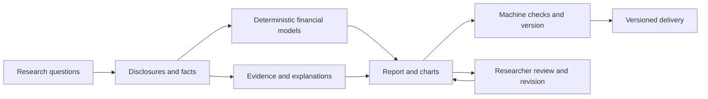

<div align="center">

# 织光 ZhiGuang · WeaveMind

**Understand what drove profit, where cash came from, and what to check next.**

An open-source workbench for listed-company operating research

[](https://github.com/momang85/weavemind/actions/workflows/ci.yml)
[](LICENSE)
[](#current-capabilities-and-boundaries)

[中文](README.md) · English

[What you can do](#what-you-can-do) · [Sample research](#see-the-analysis-in-real-disclosures) · [Try it](#quick-start) · [Architecture](#architecture) · [Roadmap](#roadmap)

</div>

Start with a company and a research question. **WeaveMind turns public disclosures into a research draft you can inspect, recalculate, and revise**: the main judgment, its numerical drivers, the supporting disclosure, alternative explanations, and the next observation that could change it. AI helps organize questions, find materials, and explain observations; registered financial models calculate the numbers. Reports travel with working papers, source locations, charts, and a versioned evidence package.

The main research thread is simple:

1. **Profit:** how much of the change came from revenue, gross margin, expenses, taxes, and product or regional mix?
2. **Cash:** how does consolidated profit reconcile to operating cash flow, and which items explain the cash-flow change?
3. **Next observation:** what revenue, margin, inventory, or cash-collection evidence would strengthen or weaken the assessment?

The current focus is **two-period operating research for non-financial A-share listed companies**. Independent analysts and small research teams are the first trial users; bank investment research and corporate-client research are the longer-term institutional direction.

**Read a sample before installing:** [Yanghe report](docs/evidence/20261007b-sample/report.md) · [PDF](docs/evidence/20261007b-sample/report.pdf) · [2025H1 research update](docs/evidence/20261007b-sample/continuation_page.md) · [Sany judgments](docs/evidence/20261007-sany-direction/reader_front.md). These public examples need no model credentials to read.

> **Research preview, as of 2026-10-07.** Source-backed examples show different judgments for declining and improving companies, with missing evidence kept visible. An existing Yanghe task's version adoption and export path has been checked; the latest plan comparison and half-year update are offline production-chain samples. Machine acceptance, research status, and human review remain separate.

## See the analysis in real disclosures

The reference cases use issuer annual reports for **2023–2024**. Figures below are rounded to **CNY billion**; the examples are historical research material.

| Research question | Yanghe — 002304.SZ | Sany Heavy Industry — 600031.SH |
|---|---|---|
| What drove the change in profit attributable to shareholders? | **−3.343**: revenue-scale effect **−3.154**, gross-margin effect **−0.647**, below-gross-profit contribution **+0.458** | **+1.448**: revenue-scale effect **+1.197**, gross-margin effect **+0.188**, below-gross-profit contribution **+0.062** |
| How did taxes contribute? | **+1.164** buffered the profit decline; it did not reverse it | **−0.112** reduced the profit improvement |
| What changed in operating cash flow? | **−1.502**; working-capital adjustment changes contributed **+1.104**, softening the decline in consolidated profit | **+9.106**; working-capital adjustment changes contributed **+7.977**, a major part of the cash increase |
| Which question follows from the numbers? | Will volume and company inventory improve together, and will the tax buffer recur? | Will the cash improvement persist, and will its support shift from payable adjustments to receivable release? |


The same analysis produces **different judgments when the numbers change**: Yanghe's tax movements buffer a decline; Sany's tax movements drag on an improvement. When volume and price inputs are absent, the report keeps a gap instead of supplying a quantity or pricing conclusion. Working-capital attribution alone does not establish changes in supplier payment terms or sustainable cash generation.

The [latest Yanghe sample](docs/evidence/20261007b-sample/report.md) also compares the original **2024 revenue-growth plan of 5%–10%** with the frozen full-year actual **−12.83%**. Its [research update](docs/evidence/20261007b-sample/continuation_page.md) uses **2025H1 versus 2024H1** to test earlier hypotheses: volume pressure continues, company inventory falls, and receivable release changes the cash buffer. Half-year and full-year amounts are kept separate. This is a replay of historical disclosures, not a prospective forecast test.

**Validation scope:** the latest Yanghe PDF has **11 pages** and comes from an **offline production-chain sample**. Its retained acceptance record is `pass`, its research status is `research_draft`, and human review is incomplete. The [Sany sample](docs/evidence/20261007-sany-direction/report.md) is also offline, with a retained machine-acceptance record of `pass` and incomplete research/review. Separately, an [existing Yanghe task's adoption and export check](docs/evidence/20261007-normal-entry.md) matched the report, PDF, and package download bytes. A new live task can have different retrieval coverage and still needs end-to-end validation.

## What you can do

| Capability | What it gives a researcher |
|---|---|
| **Explain profit changes** | A reproducible bridge from gross-profit changes to net-profit changes, separating revenue-scale and margin effects, then disclosed below-gross-profit items |
| **Read operating segments** | Product, region, industry, and sales-channel comparisons where compatible disclosures exist; volume and implied unit-revenue analysis where scope matches |
| **Reconcile profit to cash** | A bridge based on the cash-flow statement's supplemental reconciliation, using consolidated profit and disclosed signed adjustments |
| **Attribute cash-flow changes** | Changes in profit, non-cash items, working-capital adjustments, other items, and any unreconciled residual |
| **Test conditional scenarios** | Parameterized sensitivity and reverse thresholds, such as the margin required to preserve base-period profit under a revenue assumption |
| **Check the evidence** | Facts retain company, period, unit, and source; calculations retain inputs and formulas; unanswered questions remain visible |
| **Compare plans with actuals** | Locate an earlier disclosed numerical plan and compare it with same-company, same-period, same-basis frozen actuals |
| **Update a research hypothesis** | Use a later disclosure to show which observations strengthen, weaken, or leave an earlier hypothesis unresolved |
| **Revise and deliver** | Edit the report, rerun machine checks, and export a corresponding report version with working papers and evidence |
| **Challenge a judgment in the research lab** | Pick a study, entity, candidate run, view and item; read the retracement at λ=0/50/100% and the reversal threshold λ* |
| **Update on a new disclosure** | Pick the earlier mechanism snapshot and a later same-company material; each hypothesis reports strengthened / weakened with its criteria hash |
| **Update along a frozen baseline** | Explicitly choose a saved experiment: the earlier side's readings and criteria are copied from the frozen JSON, not rebuilt in place (no baseline ⇒ labelled a historical rebuild) |
| **Compare with market reaction** | Explicitly choose the disclosure event, price dataset, trading calendar and evaluation date; read 1/5/20-trading-day stock, benchmark and **geometric relative** returns **side by side** with the operating judgment |

The default **operating-research combination** uses three existing model families: operating drivers, cash reconciliation, and conditional scenarios. Basic profit bridges, cash-quality ratios, working-capital analysis, and profit-to-cash comparisons remain available for narrower questions.

Market comparison anchors on the close of the disclosure day (or the last trading day before it) and uses only information available up to that day; relative return is `(1+stock)/(1+benchmark)−1`, close to close. Prices and calendars come from datasets and calendars already registered on this machine, each reading carries its own licence mark, and readings under an internal-only licence are withheld from any external delivery package (which keeps a restriction note and per-member hashes).

The default **operating-research combination** uses three existing model families: operating drivers, cash reconciliation, and conditional scenarios. Basic profit bridges, cash-quality ratios, working-capital analysis, and profit-to-cash comparisons remain available for narrower questions.

### AI explanations, reproducible calculations



Models are chosen from a registry with declared inputs, reporting bases, outputs, and checks. The financial-analysis path does not ask an LLM to invent and execute arbitrary formulas. Missing inputs limit the analysis instead of being filled with convenient numbers.

A numerical decomposition explains the **composition of a change**. Connecting it to a business cause still requires disclosure evidence and researcher interpretation. For example, an increase in implied unit revenue can reflect product mix as well as pricing.

## Who it is for

| Users | A good first use |
|---|---|
| **Independent analysts and researchers** | Read an annual report, compare two years, check the main drivers, and prepare a research draft |
| **Small investment research and private-fund teams** | Share the report together with the facts, calculations, open questions, and source references |
| **Consultants and corporate researchers** | Prepare company briefings, management-interview questions, and lists of materials to obtain |
| **Bank investment and corporate-client researchers** | Explore public-information research in a controlled pilot; institutional controls and internal-data deployment are later work |
| **Financial-tool developers** | Extend sources, registered models, or research workflows using MIT-licensed code |

Automated trading, automated credit decisions, target prices, and return promises are outside the current product scope. Conditional scenarios are calculations under assumptions, not probability forecasts.

## Quick start

### Windows source checkout

Prepare **Python 3.11** and **Git**, and add Python to `PATH` during installation. The launcher checks dependencies, prepares a portable Redis when needed, starts services, and opens the workbench. First launch may download dependencies and Redis. The tracked frontend build allows a normal trial without installing Node; frontend development requires Node and npm.

```powershell
git clone https://github.com/momang85/weavemind.git
cd weavemind
.\start.bat
```

1. Use the address shown by the launcher, normally **http://localhost:8080**. If the port is occupied, use the actual address printed at startup.
2. Complete the browser's first-use guide: create the administrator account, then configure an **OpenAI-compatible model endpoint**, model name, and credentials, plus any embedding settings you need. There is no fixed default administrator password.
3. Submit a company research task, inspect the report and working papers, then revise or export the result.
4. Double-click `stop.bat` to stop the local services.

Local model settings can be configured in the page or with `python setup_wizard.py`. The source launcher does not automatically load the `.env` used by Compose.

Real research uses your configured model and data services. Model calls may incur charges; latency and retrieval coverage depend on your provider, network, and task scope. Local deployment stores workspace artifacts locally, while configured remote services receive the requests needed for the task.

For the latest analysis features, start with the source checkout above. The project includes scripts for bundled Windows packages containing Python, dependencies, Redis, and the frontend; a public package synchronized with the current source remains to be verified. See the [Windows newcomer guide](docs/新人上手指南.md) for setup and troubleshooting.

### A first research request

```text
经营研究 / Operating research: 洋河股份 (Yanghe, 002304.SZ), comparing 2023 and 2024.
Use consolidated statements and an information cutoff of 2025-04-30.

Explain:
1. The main revenue, margin, expense, and tax contributions to profit changes.
2. How consolidated profit reconciles to operating cash flow, and what changed.
3. The gross margin required to preserve base-period profit if revenue rises 5%.

Show the calculations, relevant disclosure locations, alternative explanations,
and the next observations needed to test the judgment.
Deliver a concise report, three analysis charts, and recalculable working papers.
```

For a cash-focused second task:

```text
经营研究 / Operating research: 三一重工 (Sany Heavy Industry, 600031.SH), comparing 2023 and 2024.
Use public disclosures available by 2025-04-30.
Explain the increase in operating cash flow: what came from profit,
non-cash adjustments, receivables, inventories, and payables?
Discuss which improvements may persist and what to observe next period.
```

The examples retain the keyword **经营研究** because the current question classifier uses Chinese keywords to select the operating-research combination. Source-backed demonstrations can also be read from the links above before configuring a model service. A new live task may retrieve different material and can have different coverage. Use the task's **add-materials** action to supply an official disclosure URL or a file within the page's supported format and size limits, then inspect the admitted material and revised draft.

### Other deployment paths

| Path | Entry point | Notes |
|---|---|---|
| Linux / macOS | `bash start.sh` | Requires a usable Python runtime and Redis environment; platform validation is less extensive than Windows |
| Docker Compose | Copy [.env.example](.env.example) to `.env`, fill service settings, then `docker compose up --build -d` | Read the deployment guide for configuration persistence, PDF fonts, and code-execution isolation |
| Manual / restricted-network setup | [Deployment guide](docs/部署指南.md) | Includes dependencies, Redis, configuration, operations, and offline-install guidance |

Some historical startup instructions in the deployment guide still need updating; use the current source-start steps above as the primary reference.

For local runtime information, use `python launcher.py status`, `python launcher.py readiness`, or `python launcher.py diagnostics diag.txt`. Diagnostics are saved locally in a redacted form.

## What you receive

| Deliverable | Purpose |
|---|---|
| **Research report and PDF** | Main findings, driver contributions, scenarios, supporting evidence, and questions still open |
| **Working papers: CSV / JSON** | Facts, reporting bases, formulas, derived inputs, and gaps for recalculation |
| **Analysis charts** | Profit contributions, profit-to-cash reconciliation, and scenario thresholds where the data supports them |
| **Analysis records** | Selected model runs, parameters, dataset, and detailed cards for checking the reported calculation |
| **Source locations and excerpts** | References back to the available disclosure material |
| **Versioned evidence package** | The corresponding report and artifacts, with a member manifest and file hashes |

Three statuses remain separate: **machine validation**, **research-question coverage**, and **human review**. A machine-validated calculation can support a draft whose business explanation is still incomplete. Drafts can be retained and exported with their actual status while evidence is being improved. Package hashes help establish artifact consistency; they do not prove that a research conclusion is correct.

## Current capabilities and boundaries

| Area | Current position |
|---|---|
| Analytical core | Source-backed Yanghe and Sany cases cover profit bridges, cash reconciliation, cash-change attribution, and conditional thresholds; judgment direction follows the input numbers |
| Research lab | The ordinary research page can challenge a judgment (retracement and λ*), update it on a new disclosure, update **along a frozen baseline**, and attach a 1/5/20-trading-day **market comparison**; nothing is presented as a conclusion before human review |
| Integrated report path | Adoption/reassembly and export of an existing Yanghe task have been checked against report/PDF download bytes and package hashes; the latest 11-page sample with a half-year update is offline. A new live end-to-end task remains to be validated |
| Business interpretation | Judgments carry numerical drivers, evidence type, alternative explanations, and follow-up conditions. Plan-versus-actual, later-disclosure updates, and a frozen-baseline annual update with three market windows have offline examples; causal explanations and researcher usefulness still require review |
| Data coverage | A-share non-financial annual disclosures are the main path; supported layouts and completeness vary by issuer and year |
| Other markets and sources | Hong Kong, US, news, macro, and other adapters exist, but their presence is not a claim of equivalent retrieval or research quality |
| Quantitative extensions | Event observations, an internal backtest prototype, and a licence gate that keeps restricted readings out of delivery packages exist; Qlib is an export/delegation direction, not an integrated validated workflow |
| Institutional use | Public-information pilot direction; bank production readiness, internal-data workflows, and human research-value scores have not been established |

Disclosure sites and third-party APIs can be unavailable. The project includes source adapters, official-document paths, caching, and explicit gap reporting, but does not claim unrestricted access to every financial database. Original PDF locations depend on available material and extraction quality; an API source may only provide field or excerpt locations.

## Architecture

A **Python multiprocess modular application** with a React / TypeScript workbench. Redis carries queues and messages; SQLite stores task, session, and audit records; the file workspace retains research artifacts; ChromaDB supports memory retrieval. Financial analysis extends this existing chain rather than adding a separate modeling service.

| Layer | Main code | Responsibility |
|---|---|---|
| Workbench and API | [frontend/](frontend/), [web_ui.py](web_ui.py) | Task submission, plans, analysis, revisions, downloads, and configuration |
| Orchestration | [orchestrator_v2.py](orchestrator_v2.py), [execution_contract.py](execution_contract.py) | Research scope, execution plans, dispatch, and budgets |
| Sources and evidence | [adapters/](adapters/), [facts.py](facts.py), [narrative_evidence.py](narrative_evidence.py) | Retrieval, structured facts, source locations, and explanatory evidence |
| Calculations | [financial_analysis/](financial_analysis/), [working_paper.py](working_paper.py) | Dataset → analysis plan → registered model run; deterministic calculations and working papers |
| Research draft | [question_assessment.py](question_assessment.py), [report_brief.py](report_brief.py) | Question coverage, report assembly, and research gaps |
| Validation and delivery | [acceptance_checker.py](acceptance_checker.py), [report_version.py](report_version.py), [delivery_pipeline.py](delivery_pipeline.py) | Machine checks, report versions, frozen snapshots, and packages |
| Runtime | [launcher.py](launcher.py), [llm_client.py](llm_client.py), [root_budget.py](root_budget.py) | Services, compatible model calls, and usage budgets |

The key analytical objects are **Observation → Dataset → AnalysisPlan → ModelRun**. Facts and model results retain their identities across reporting and delivery so researchers can inspect the calculation behind a sentence.

## Roadmap

The development priority is **a useful research draft that improves with each new disclosure**, demonstrated through a few reproducible cases. Improvements reuse existing operators and delivery modules.

| Stage | Goal | Next visible result |
|---|---|---|
| **Now · Make the draft useful to a researcher** | Keep a clear first-page judgment and move full workings into matching attachments | Shorter main reports, explicit research gaps, and human feedback on usefulness; current report compression has not yet reached the 4–6-page goal |
| **Next · Follow a judgment through new disclosures** | Build on the existing plan-versus-actual and half-year continuation samples | More company cases with same-period comparisons and clear evidence for changing a hypothesis |
| **Next · Validate the live trial experience** | Repeat retrieval, revision, and export on a new task | A reproducible end-to-end run with version-consistent report, PDF, and evidence package |
| **V2 · Model realistic operating conditions** | Combine meaningful revenue, margin, expense, tax, and working-capital assumptions | A small set of understandable levers and a threshold that changes the judgment, with consistent page and export results |
| **V3 · Add history and peer context** | Assemble a narrow 3–5-year series from adjacent reports and then add one relevant peer | A research update showing which drivers have changed and whether they are company-specific |
| **Next · Add models that earn their place** | With sufficient data and a clear question, evaluate cost elasticity, seasonality, or another suitable model | Answers the current decompositions cannot provide, with out-of-sample evaluation |
| **Later · Institutional collaboration** | Add team review, institutional isolation, identity integration, and operational validation | Controlled deployment for banks and larger research teams |

Later institutional work will add the collaboration, identity, authorization, data-destination controls, and deployment operations needed for bank pilots. Default-probability (PD) modeling and transaction-fraud research are planned directions. More models will be added when they answer a research question the current decomposition cannot answer, with enough data to evaluate them.

Planned functionality is not a claim of completed validation.

## Before your first trial

**Do I need a paid model service?** You need an accessible compatible API. Charges depend on the service and calls made. Deterministic calculations on existing material do not require a model to recalculate the numbers, while a complete research task can still call models.

**Does local deployment keep everything local?** Task records, caches, and artifacts live on your machine or server. Configured remote models, embedding services, and retrieval services receive their corresponding requests and the necessary content.

**Can I continue when search fails?** Inspect the gaps, then add an official disclosure URL or a supported file. Availability and extraction limits still affect what can be answered.

**Is Docker required for financial analysis?** Registered deterministic financial operators do not require a separate code sandbox. Arbitrary code-execution tasks require the isolation setup described in the deployment guide.

**Can I use the result as a final investment or credit decision?** The current product supports drafts, checks, and discussion. Final conclusions require the user's complete evidence and human review.

## Documentation and contribution

Most detailed project documents are currently in Chinese.

| Topic | Read |
|---|---|
| First launch | [Windows newcomer guide](docs/新人上手指南.md) |
| Installation and operations | [Deployment guide](docs/部署指南.md) |
| Building a Windows package | [Package build guide](docs/新人运行包构建说明.md) |
| Current model registry | [Financial-analysis registry](financial_analysis/registry.py) |
| Latest public research sample | [Yanghe report](docs/evidence/20261007b-sample/report.md), [PDF](docs/evidence/20261007b-sample/report.pdf), [half-year update](docs/evidence/20261007b-sample/continuation_page.md), [Sany report](docs/evidence/20261007-sany-direction/report.md) |
| Case evidence and validation scope | [Plan comparison and update evidence](docs/evidence/20261007b-target-and-h1-continuation.md), [existing-task export check](docs/evidence/20261007-normal-entry.md) |
| Research lab: market comparison and frozen baseline | [C5 evidence package](docs/evidence/20261012-c5-review/README.md), [licence gate and version-selection seam](docs/evidence/20261011-c4-review/README.md) |
| Contributing and community | [Contribution guide](CONTRIBUTING.md), [code of conduct](CODE_OF_CONDUCT.md), [security feedback](SECURITY.md) |
| Development checks | [CI workflow](.github/workflows/ci.yml) |

Try a research question you already understand, compare the draft with your own judgment, and tell us **which insight saved work, which claim needs stronger evidence, and which observation you would check next**. Share feedback, reproducible issues, and de-identified public-data cases through [GitHub Issues](https://github.com/momang85/weavemind/issues).

Useful contributions include issuer-table adapters, source-backed analytical examples, clearer reports and charts, and small model extensions with explicit assumptions. Run relevant existing regressions and build checks for the code you change.

For frontend development:

```bash
npm ci --prefix frontend
npm run dev --prefix frontend
```

The development frontend normally runs on port `5173` and requires the backend. Build the bundled frontend with `npm run build --prefix frontend`.

Released under the **[MIT License](LICENSE)**. Third-party data and model services have their own terms.
