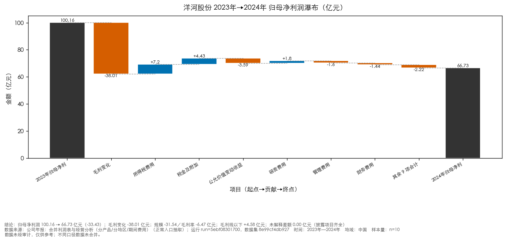
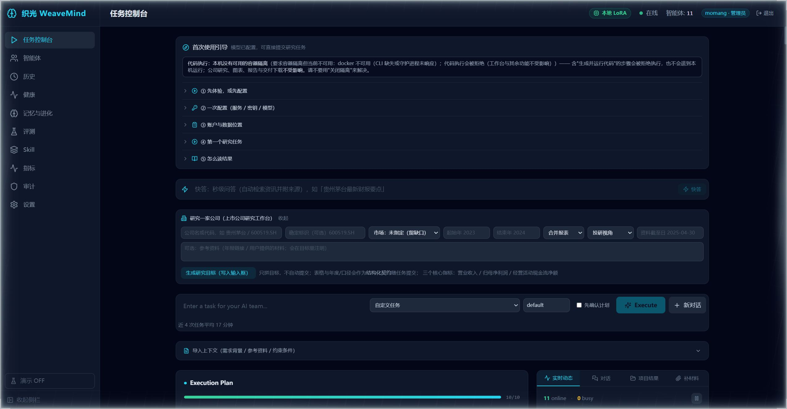
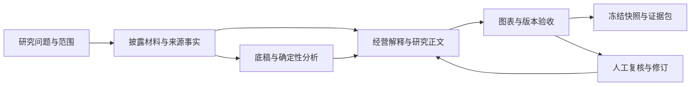

<div align="center">

# 织光 ZhiGuang · WeaveMind

**把公开披露，变成有数字、有出处、能持续检验的研究判断。**

开源 AI 上市公司研究工作台 · 财报问答 / 经营分析 / 持续跟踪

[](https://github.com/momang85/weavemind/actions/workflows/ci.yml)
[](LICENSE)
[](#当前进展)

中文 · [English](README.en.md)

[看真实案例](#先看两个真实案例) · [开始试用](#快速开始) · [核心能力](#现在能做什么) · [发展路线](#接下来怎样变得更有用) · [参与项目](#欢迎一起打磨)

</div>

织光（WeaveMind）是一款开源的AI金融研究工作台，面向独立研究员、个体分析师和小型投研团队，并以银行投研与对公客户研究为长期方向。当前聚焦A股非金融上市公司，把公开年报、财务数据和研究问题整理成正文、图表、可复算底稿、来源定位与版本证据包。适合年报阅读、经营拆解与现金核查等场景。

它将AI理解与确定性计算结合，拆解收入、毛利、费用和税项对利润变化的贡献，核对利润怎样转成现金，识别应收、存货与应付的影响，再通过情景和反向阈值回答“什么条件会改变结果”。同一套逻辑随公司数据变化，材料不足时明确缺口，帮助研究者找到值得追问的问题。

织光已有经营计划与实际对照、后续披露更新旧判断的样品，支持跟踪假说被加强、削弱或仍未知。数字、解释与假设分开呈现，正文、图表和底稿绑定对应版本，便于复算、讨论与交接。

项目支持本地部署，Windows源码通过统一启动入口打开浏览器工作台，完成首次模型配置后开始研究。MIT许可方便开发者扩展数据源与分析算子。当前处于研究试用阶段，机器验收、研究状态和人工复核独立展示；未来继续完善短篇报告、事件研究、量化验证与企业风险分析，让个体研究与机构协作获得更有力的证据支持。

**先看效果，无需安装或配置模型：** [洋河报告](docs/evidence/20261007b-sample/report.md) · [PDF](docs/evidence/20261007b-sample/report.pdf) · [2025H1 研究续页](docs/evidence/20261007b-sample/continuation_page.md) · [三一关键判断](docs/evidence/20261007-sany-direction/reader_front.md)。想研究自己的公司，直接跳到[快速开始](#快速开始)。

## 为什么值得试用

| 你关心的事 | 织光怎样帮助你 |
|---|---|
| **看清变化由谁贡献** | 用利润桥和现金桥说明主要金额、方向及对账差额，继续追问业务机制 |
| **方便回查与复算** | 关键数字连到底稿、输入与披露定位；正文、图表、附件一起按版本交付 |
| **让研究能继续** | 保留假说、反证与下一观察，用后续披露更新旧判断 |
| **适合研究者掌握节奏** | 先看已有案例，再补材料、改假设、选版本和导出；缺证据的地方明确展示 |

## 先看两个真实案例

基于洋河股份、三一重工的 2024 年年报及其中的 2023 年比较数据，使用同一套分析核心得到以下结果。金额单位均为亿元。

| 研究问题 | 模型算出了什么 | 研究员可以继续追问什么 |
|---|---|---|
| **洋河：利润为什么下降？** | 归母净利润减少 **33.43**；毛利变化 **−38.01**，其中收入规模贡献 **−31.54**、毛利率贡献 **−6.47**；税项贡献 **+11.64** 缓冲下降，毛利线以下净贡献 **+4.58** | 销量、产品结构、区域经营分别支持什么解释？税项缓冲能否持续？ |
| **洋河：现金与利润如何联动？** | 经营现金流减少 **15.02**；合并净利润变化 **−33.54**，营运资本项变化 **+11.04** 提供缓冲，其余来自非现金项与其他调节项 | 资金占用拖累减轻，是否足以抵消盈利下滑？ |
| **三一：现金增长的来源是什么？** | 经营现金流增加 **91.06**，其中营运资本项变化贡献 **+79.77**；利润改善中的税项贡献为 **−1.12** | 应收、存货、应付各贡献多少？哪些改善可重复，哪些可能与结算时点有关？ |



这些是**会计分解与条件计算**，业务原因和可持续性需要结合经营披露判断。分产品、分地区是不同切法；单位收入也可能包含产品结构变化。

同一套分析会给出不同判断：洋河税项缓冲利润下降，三一税项拖累利润改善；缺量价读数时保留缺口。会计贡献回答“变化怎样组成”，商业原因仍需披露支持。

**从一次报告到持续跟踪：** 最新洋河样品把原披露的2024年收入增长计划 **5%–10%** 与全年实际 **−12.83%** 对照；研究续页再用 **2025H1 对 2024H1** 检验销量、企业库存与现金构成的变化。半年与全年分别保留，形成可追问的研究记录。

- 读当前样品：[洋河正文](docs/evidence/20261007b-sample/report.md) · [三一正文](docs/evidence/20261007-sany-direction/report.md) · [后续披露更新](docs/evidence/20261007b-sample/continuation_page.md)。
- 查底稿与交付：[PDF](docs/evidence/20261007b-sample/report.pdf) · [完整解释和来源定位](docs/evidence/20261007b-sample/analysis_detail.md) · [包清单与核对记录](docs/evidence/20261007b-sample/package.json)。
- 看验证范围：[新样品执行记录](docs/evidence/20261007b-target-and-h1-continuation.md) · [已有洋河任务的采纳与导出复验](docs/evidence/20261007-normal-entry.md)。

> 更新于 **2026-10-07**。最新洋河 PDF 为 **11页离线样品**，留档机器验收为 `pass`，研究状态为 `research_draft`，人工复核未做；研究续页是历史材料回放。三一也为离线样品。已有洋河任务的采纳、重装配、导出和下载一致性另有复验记录；新的实时任务还会受到资料、模型与网络条件影响。主文4–6页是下一步目标。

<details>
<summary>查看工作台界面：首次引导、公司范围与研究任务</summary>



界面留档于2026-10-06，截图中的环境状态属于该实验机器；你的启动状态以本机引导为准。

</details>

## 现在能做什么

### 一次经营研究，组织三个问题

| 分析能力 | 输出内容 | 使用前提 |
|---|---|---|
| **经营驱动与利润分解** | 收入规模与毛利率贡献、毛利线以下费用/税项贡献；有披露时加入分产品、分地区及量价分解 | 同主体、同口径的两期数据；分段和销量分析需要对应披露 |
| **现金形成与现金变化** | 从合并净利润逐项调到经营现金流；分解两期现金变化中的利润、非现金、营运资本、其他与对账差额 | 现金流量表及补充资料；缺失项目保留为缺口或未解释差额 |
| **条件情景与反向阈值** | 改收入、毛利率等假设，观察结果；反推维持基期利润所需的条件 | 当前简明模式固定毛利线以下净额，结果需要结合该假设解释 |

系统按研究问题与数据齐备程度选择已注册模型。现有分析库还包括利润桥、现金质量、营运资本敏感性、利润转现金，以及常用财务比率。默认“经营研究”将前三类组织为一条分析线。

### 从分析结果到可复核交付

- **范围跟着任务走**：公司、期间、报表口径与资料截止日贯穿资料整理、计算和成稿。
- **数字保留来路**：披露事实与派生计算分开保存，底稿保留单位、来源、输入与算式；核心来源表支持跳转原 PDF 页码。
- **正文、图和底稿使用同一组选定结果**：保存数据集、分析计划、运行结果与分析卡，便于查验参数和版本。
- **缺口有下一步**：逐问题评估证据，指出还需要什么资料、缺口影响什么判断。
- **可以补材料与修订**：通过“补材料”加入披露直链或符合页面限制的文件；检查候选正文、修改报告，再验收与导出。
- **比较目标与结果**：将原经营计划与同主体、同期间、同口径的冻结实际读数对照，保留各自披露时点和定位。
- **用新材料更新旧判断**：研究续页展示新证据怎样支持或削弱原假说，以及下一期仍需观察什么。
- **交付保留快照**：正文、PDF、图表、底稿与证据按版本打包，附清单和文件哈希，方便交接与复核。

### 研究实验台：挑战判断、市场对照、沿原判更新

研究页里另有一个窄入口，把「评分值假设 → 更新披露 → 保存行动」做成可复算的一步：

| 能做 | 怎么用 | 边界 |
|---|---|---|
| **改动关键假设** | 选研究 → 选主体与候选 run → 选视角与候选项，看 C 在 λ=0/50/100% 三个点的回撤与反转阈值 λ* | 只传标识与枚举；数字、阈值与公式由服务端从冻结结果解析 |
| **新材料更新旧判断** | 选旧机制快照与新披露材料（同公司、晚于旧截止），读每条假说的支持/削弱与判据哈希 | 两期口径各自成立，不相减、不乘二；缺材料如实 pending |
| **沿冻结原判更新** | 显式选一个**已保存实验**作原版：较早一侧的读数与判据照抄冻结 JSON | 不现场重建旧判断去冒原假说；无原版时明确标为「历史重建」 |
| **市场对照（可选）** | 显式选披露事件、行情集、交易日历与评价时点，读 1/5/20 交易日的股票 / 基准 / **几何相对**表现，与经营判断**并列**展示 | 缺件如实 pending，跨公司或口径不符即拒绝；不隐式取数、不拿别的数据集顶替 |

锚点是披露日（或其前最后一个交易日）收盘，只用披露日前的信息；相对表现按 `(1+股票)/(1+基准)−1` 计算（收盘对收盘）。行情与日历都取自本机已登记的行情集/日历 id，读数自带许可标记——**免费源行情默认仅内部试验**，这类读数不会随对外交付包外发（包内留限制说明与逐条哈希）。

机器验收、研究状态、人工复核分别展示。文件哈希用于确认产物一致性；研究结论的价值仍由资料、论证和人的判断决定。

## 适合谁、适合什么场合

| 使用者 | 适合先尝试的工作 |
|---|---|
| **独立研究员 / 个体分析师** | 年报阅读、公司经营拆解、现金质量核查、研究初稿与底稿整理 |
| **小型投研团队** | 同口径复算、复核交接、讨论关键假设、持续跟踪一家公司 |
| **银行投研 / 对公客户研究人员** | 用公开披露做企业经营研究、准备客户讨论材料；现阶段适合研究试点 |
| **金融学习者 / 开源开发者** | 观察披露数据怎样进入计算和报告，复现案例，扩展一个有实际用途的分析算子 |

当前重点是上市公司经营研究。自动交易、自动授信、目标价与收益承诺不在项目范围内。银行正式部署所需的机构隔离、身份集成、合规和运维验证留待机构产品阶段。

## 快速开始

### Windows：先体验当前源码

准备 **Python 3.11**（安装时勾选加入 PATH）与 Git，在 PowerShell 中执行：

```powershell
git clone https://github.com/momang85/weavemind.git
cd weavemind
.\start.bat
```

也可以取得仓库源码后，直接双击目录中的 `start.bat`。启动入口负责依赖自检、Redis 准备与服务启动，首次安装可能需要下载依赖。

**守护模式默认开启**：启动后一个独立后台进程每 30 秒巡检服务，`orchestrator` / `critic` 等关键进程崩溃会自动重启，重启事件写入 `logs/audit.jsonl`（`action=process_restarted`）并在 `orchestrator:alert` 通道告警。调试时想关闭自动重启，启动前设置环境变量 `WEAVEMIND_SUPERVISE=0`；`stop.bat` 会先收掉守护进程再停服务。详见[部署指南](docs/部署指南.md)。

1. 按启动器给出的地址进入浏览器，默认是 `http://localhost:8080`；端口占用时以实际地址为准。
2. 按首次引导创建管理员，配置兼容 API 的地址、模型名称和密钥。没有固定默认管理员密码。
3. 用“研究一家公司”表单或下面的提示词提交任务；完成后先读关键判断、问题覆盖与资料缺口。

仓库包含已构建前端，普通试用无需先安装 Node.js。修改前端时才需要 Node/npm。本地模型配置可通过页面或 `python setup_wizard.py` 完成；源码启动不会自动读取 Compose 的 `.env`。

**先做一家公司、一个明确问题。** 第一次可直接复制下面的任务，获得利润、现金与后续观察的组合分析；完成后读正文，打开底稿复查一个数字，再尝试修改一个情景参数。

```text
洋河股份（002304）2023/2024 经营研究。
以官方年报为核心，合并口径，资料截至 2025-04-30。
回答：利润由何而来、现金为何变化、什么条件会改变判断。
给出主要金额贡献、披露支持、替代解释和后续观察指标。
每个关键数字可回查来源、可复算；缺资料明确列出缺口。
```

再试一份现金问题更突出的任务：

```text
三一重工（600031）2023/2024 经营研究，资料截至 2025-04-30。
重点解释经营现金流增长：合并净利润、非现金项、应收、存货和应付各有什么贡献？
结合披露讨论改善能否持续，并列出下一期需要观察的指标。
```

资料不足时，在任务中打开**补材料**，添加官方披露直链或符合页面大小限制的文件，检查材料准入与候选正文。缺口清单可以帮助缩小补充范围。外部站点受限时，优先利用已取得的原始披露资料。

**继续追踪时可以这样提问：**

```text
在上次洋河2023/2024研究基础上，用2025年半年报更新旧判断。
新资料截止为2025-08-20，新增数值只比较2025H1与2024H1。
检查税费缓冲、销量与企业成品库存、应收和应付的现金贡献。
逐条列出：原假说、新证据、加强/削弱/仍未知、下一观察及来源。
保留原报告版本；材料不足时说明尚缺什么。
```

这条跟踪路径已有离线样品，实时任务的获取、抽取和成稿覆盖仍需检查。模型与外部数据服务使用自己的配置；首次体验从一个问题开始，便于了解调用成本和交付质量。

### 启动遇到问题

先按启动器显示的“下一步”处理。需要核实地址、服务与就绪状态时：

```powershell
python launcher.py url
python launcher.py status
python launcher.py readiness
python launcher.py diagnostics diag.txt
```

诊断文件经过脱敏，不会自动上传。停止本地服务可双击 `stop.bat`。更多说明见[新人上手指南](docs/新人上手指南.md)。

### 其他运行方式

- **Windows 便携运行包**：如果已经取得维护者提供的包，解压后双击 `start.bat`，再完成模型配置。当前记录的候选包早于本轮分析能力，尚需更新打包与验收；公开下载以 [Releases](https://github.com/momang85/weavemind/releases) 为准。体验最新分析功能请先用源码。
- **Linux / macOS**：准备 Python 与 Redis，运行 `bash start.sh`。
- **Docker Compose**：复制 `.env.example` 为 `.env`，填写模型配置，再运行 `docker compose up --build -d`；默认访问 `http://localhost:8080`，用 `docker compose down` 停止。中文 PDF 字体、配置持久化与独立代码执行沙箱需要按部署环境确认。

[部署指南](docs/部署指南.md)提供配置与运维参考，部分历史启动说明待同步；当前启动入口与以上步骤为准。[运行包构建说明](docs/新人运行包构建说明.md)记录打包方式及验证范围。

## 会得到什么

| 产物 | 用途 |
|---|---|
| **研究正文与 PDF** | 阅读关键判断、金额贡献、证据支持、情景条件与待核查问题 |
| **利润 / 现金 / 情景图** | 快速观察主要变化与假设影响 |
| **计算底稿 CSV / JSON** | 复查事实、输入、指标与算式 |
| **分析数据与运行记录** | 查看数据集、计划、参数、结果、规则与来源定位 |
| **研究续页** | 对照旧假说与新披露，记录加强、削弱、仍未知及下一观察；当前已有离线样品 |
| **版本与证据包 ZIP** | 将同一版本的正文、图表、底稿和证据交给复核者 |

具体产物取决于任务资料、实际执行结果与交付状态。研究工作台允许保留草稿，补证据后继续完善。

## 当前进展

更新于 **2026-10-12**，以下区分现有能力、公开样品与继续研发的范围。

| 层面 | 当前状态 |
|---|---|
| 分析核心 | 已有经营驱动、利润/税项贡献、现金变化桥、条件情景与反向阈值；判断随数值方向和可用性变化 |
| 研究实验台 | 普通研究页可改关键假设看法回撤与反转阈值、用新材料更新旧判断、**沿冻结原判**显式更新、并对接 1/5/20 交易日**市场对照**；未复核前不冒充结论 |
| 真实案例 | 洋河与三一的官方披露用于同一核心；两公司方向与缺量价读数的降级已有限定复核 |
| 计划与持续跟踪 | 已有原经营计划对冻结实际的样品、2025H1同期披露更新旧命题的样品，以及 2026-04-28 年报沿冻结原判更新＋三窗口市场对照；后续仍需更多公司验证 |
| 交付接入 | 已有洋河任务的采纳/重装配、导出和下载一致性复验；最新计划/续页样品为离线生产链，不是新任务全流程验收 |
| 新人入口 | 统一 `start.bat` / `launcher.py` 与首次配置引导；新分析功能的便携包待同步 |
| 简洁交付 | 最新PDF样品11页，阅读层已有收束；4–6页主文与更清晰的续页仍是优化目标 |
| 量化与事件 | 已有授权行情CSV、事件收益观察、内部回测原型与许可门（受限读数不随包外发）；完整新闻事件流程、策略有效性与可执行回测尚待验证 |
| 信用与反欺诈 | 企业风险线索是扩展方向；校准信用评分、违约概率和交易反欺诈须有授权数据/标签，当前尚未完成 |
| 泛化与机构使用 | 更多公司、年度与报表样式的稳定性，以及银行生产部署，尚未验收 |

仓库有多市场数据适配器，当前案例与产品打磨集中在 **A 股非金融公司**。其他市场和金融公司的适配需要单独验证。两期年报支持分解与条件分析；统计预测、多期估计与全自动通用建模仍属于后续方向。

## 系统怎样工作

**AI 负责理解问题、提出解释与组织文字；确定性算子负责计算、对账和情景。** 研究员检查来源与假设，作出最终判断。



后端采用 **Python 多进程单体**：Redis 负责队列和消息，SQLite 保存任务、会话与审计，ChromaDB 支持记忆检索；前端为 React / TypeScript / Vite / Zustand。数据和产物通过既有链路流转。

| 模块 | 主要职责 |
|---|---|
| `adapters/`、`material_intake.py` | 数据源适配与披露材料摄取 |
| `orchestrator_v2.py`、`worker_base.py` | 研究计划、任务编排与 Worker 执行 |
| `facts.py`、`narrative_evidence.py` | 结构化事实、叙述证据与来源定位 |
| `working_paper.py`、`financial_analysis/` | 确定性底稿、问题驱动分析与模型运行 |
| `report_brief.py`、`charts_pipeline.py` | 研究正文与图表装配 |
| `acceptance_checker.py`、`report_version.py`、`delivery_pipeline.py` | 机器验收、版本修订与交付快照 |
| `web_ui.py`、`frontend/`、`launcher.py` | API、研究工作台与统一启动 |

扩展分析沿 **事实 → 数据集 → 分析计划 → 模型运行 → 研究判断 → 报告/续页** 这条主线进行。新能力优先复用现有对象和交付链，保持系统简洁。

## 接下来怎样变得更有用

当前主线是**分析卓越化**：先把少数真实公司研究做出说服力，再扩展覆盖。以研究洞见、解释深度与复核效率衡量进步。

| 次序 | 重点 | 用户能得到的改进 |
|---|---|---|
| **1. 读者愿意使用的报告** | 少数真实案例打磨4–6页主文、简洁续页、完整底稿与来源；新能力同步新手入口 | 更快读懂主判断，能直接回查证据 |
| **2. 持续检验经营假说** | 扩展当前年报/半年报跟踪样品，逐步加入窄指标历史与少数同行 | 看清上次判断哪些仍成立、哪些需要改写 |
| **3. 事件与量化验证** | 新闻/公告原文、公开时点和转载去重接入研究；授权行情用于事件收益与受控日频回测 | 把经营假说连接到可复核的历史表现；效果由评估决定 |
| **4. 企业风险研究** | 财务、现金与事件形成风险证据卡；合作取得标签后才推进校准信用模型与交易反欺诈 | 清楚列出核查线索、证据和适用范围 |
| **5. 机构协作与受控部署** | 团队复核、机构隔离、身份集成、数据授权、审计与运维验证 | 支持银行和较大研究团队在受控环境中协作 |

更少的重复卡片、更清楚的报告和有价值的案例，与新增模型同样重要。影响当前研究的必要问题随功能解决，维护积压单独安排。

当前自写回测仅供内部研究实验；Qlib已有导出适配，实际委托执行尚未接入。信用评分、交易反欺诈和机构生产部署按数据与验证条件推进。

## 试用前常见问题

**需要购买模型服务吗？** 你需要可访问的兼容模型 API；费用由所选提供方和任务调用量决定。已有材料上的确定性计算不需要模型重新算数，完整研究仍可能调用模型。

**本地运行，资料会留在哪里？** 任务记录、缓存与产物保存在本机或你的服务器。使用外部模型、Embedding 或检索服务时，相应请求和必要内容会发往配置的服务端；数据边界取决于所选服务与部署方式。

**搜索不到，能继续研究吗？** 可以先检查缺口并补官方披露直链或符合限制的原件。来源访问和抽取能力仍有边界，未取得的数据会影响分析覆盖。

**需要 Docker 才能做财务分析吗？** 已注册的确定性分析算子不要求先配置独立代码沙箱；需要任意代码执行时，另按部署说明配置隔离环境。

**适合直接给投资或授信结论吗？** 当前适合研究初稿、核查与讨论。正式结论由使用者结合完整资料和人工复核作出。

## 文档与开发

- [新人上手指南](docs/新人上手指南.md) · [部署指南](docs/部署指南.md) · [运行包构建说明](docs/新人运行包构建说明.md)
- [最新洋河分析](docs/evidence/u2_research_note.md) · [最新三一分析](docs/evidence/u3_sany_note.md) · [交付样品验证](docs/evidence/v0_yanghe_normal_task.json)
- [开发进展](docs/DeepSeek执行状态.md) · [分析模型注册表](financial_analysis/registry.py)
- [研究实验台证据：市场对照＋沿冻结原判](docs/evidence/20261012-c5-review/README.md) · [许可门与选版接缝](docs/evidence/20261011-c4-review/README.md)
- [贡献指南](CONTRIBUTING.md) · [行为准则](CODE_OF_CONDUCT.md) · [安全反馈](SECURITY.md)

修改前端时：

```bash
cd frontend
npm install
npm run dev
# 构建正式前端
npm run build
```

后端推荐 Python 3.11。按改动选择相关测试文件；运行依赖与 CI 入口见 `.github/workflows/ci.yml`，金融分析代码集中在 `financial_analysis/`。请使用自己的本地配置，并保护 API 密钥与研究资料。

## 欢迎一起打磨

最欢迎的贡献，是**带一个真实研究问题来试用**。告诉我们：哪条结论帮助了你，哪里解释不够，缺什么资料，你是否愿意用它研究下一家公司。

通过 [Issues](https://github.com/momang85/weavemind/issues) 提交反馈时，建议附：公司与期间、研究问题、已取得的材料、预期结果、实际结果及脱敏截图或底稿。不要提交密钥、个人信息或机构保密资料。

也欢迎补充行业案例、改进分析解释、优化图表和新人体验，或贡献一个能多回答一个研究问题的算子。重大功能可先讨论问题与最小案例，再提交实现。

织光采用 [MIT License](LICENSE)。如果这些案例对你有启发，欢迎试用、提建议、分享给研究同行，或在 GitHub 上 Star 关注后续进展。
