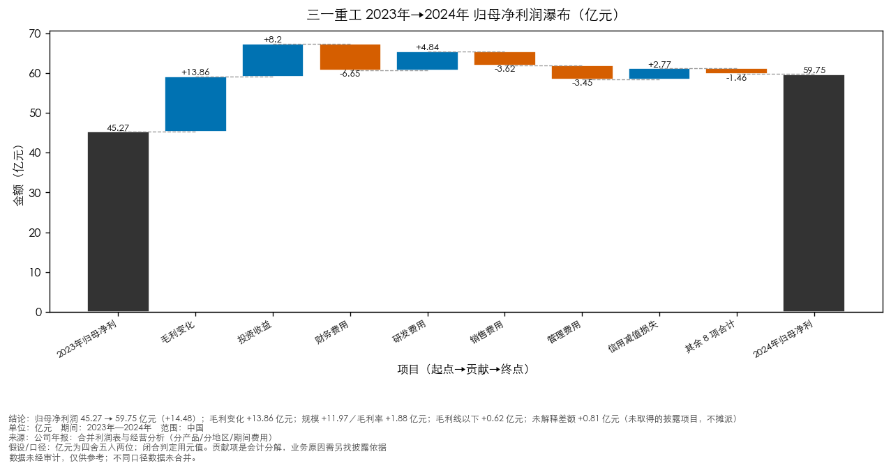
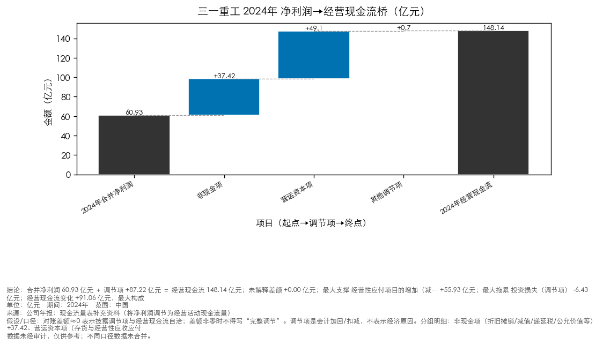
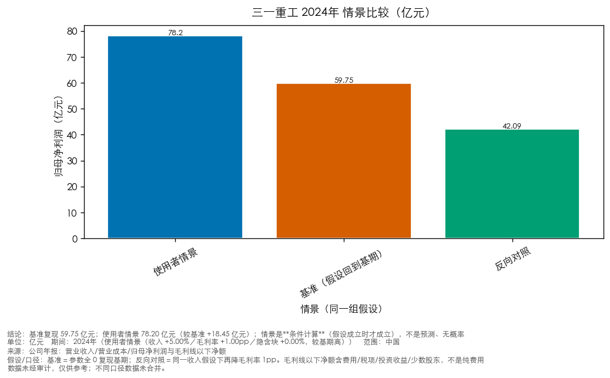

> **研究状态：研究草稿／待补原始披露**——必答问题未完成（2/3）：收入变化的量价与结构依据、利润变化的分解（其中部分覆盖 2 项：收入变化的量价与结构依据[已取得部分构成]、利润变化的分解[已取得部分构成]）；29 条肯定结论处于未证实状态（未支持/部分支持/待核查）（数字与格式的机器验收不因此改变；本条说的是**研究**是否就绪）

> **评审状态：评审未完成（降级）** —— 未执行或未完成评审。
> 本交付物未取得绑定计划版本的评审 PASS，须经人工复核后方可使用。

---

# 三一重工 经营分析简报（2023–2024 年度）

**主体**：三一重工（600031.SH）　**期间**：2023–2024 年度　**口径**：合并　**资料截止**：2025-04-30

> 报表口径：合并；数据时效：截至 2025-04-30；单位：元。
> 来源：正文引用 **1** 条（编号见『参考来源』）；另有 0 条候选材料未采用（不编号、不进正文，只留在内部审计）。

## 关键判断与下一步

> 以下 5 条由**同一次选版快照**的已验证运行与已准入披露驱动：读数、机制、替代解释与「下一份材料怎样改变判断」都写在同一处。完整桥、逐条定位与七段式明细见 `analysis/analysis_detail.md`（随交付包提供）。

1. 利润下降的主因在毛利端，**税费减少托底** -1.12亿元（已发生（读数））
   - 关键读数：归母净利润变化 +14.48亿元（＝毛利端 ＋ 毛利线以下）
   - 关键读数：毛利端变化 +13.86亿元（收入规模 +11.97 ＋ 毛利率 +1.88）
   - 关键读数：**税费减少托底** -1.12亿元（所得税费用 -1.05亿元、税金及附加 -0.07亿元）
   - 关键读数：毛利线以下其余项目合计 +1.74亿元（毛利线以下净额 +0.62亿元）
   - 机制（计算关系）：Δ归母净利润 ＝ Δ毛利端 ＋ Δ毛利线以下；毛利线以下再拆成所得税/税金及附加与其余项目——三者都是**同一份利润表的算术分解**，不含因果。
   - 机制（研究假说）：税费减少是不是**可持续**（税率、汇算清缴、递延税与一次性因素）本轮**未证**：只见金额，未见税率与应纳税所得额的说明。
   - 替代解释：税费减少来自汇算清缴/递延税等一次性因素（未证）、费用与减值计提的时点差异（未证）、收入结构与毛利率变化（同一次运行的毛利端分解）
   - 边界：这是**会计变化桥**：税费减少不能直接定性为经营改善、永久税率红利或非经常性收益；也未把毛利线以下其余项目摊派到任何单一科目
   - 下一观察：所得税费用、税金及附加、毛利率、销售量（下一期（同口径年报/半年报））；**支持**：税费减少在下一期**不再重复**、且毛利率与销量不再恶化时，本期利润的托底被读成一次性缓冲；**削弱**：若税费占收入比继续下降并成为主要托底，则利润质量与可持续性的判断需要改写
2. 收入下降的量与价：**销量收缩**是数量观察，**单位收入上升不证明提价**（已发生（读数））
   - 关键读数：量价分解未取到销量/单位收入效应
   - 关键读数：量价分解里的单位价格效应未取到
   - 边界：读数不足：不生成「销量收缩」结论，先补量价与产销量表；没有同口径的量价分解就不评价价格，不用毛利率差替代
   - 会削弱它的读数：补齐分产品产销量与收入构成后重算
3. 现金变化**主要由营运资本（占用与时点）构成**，其持续性是关键（已发生（读数））
   - 关键读数：现金桥（同一次运行，**四项相加**）：合并净利润变化 +14.86 ＋ 非现金项变化 -4.10 ＋ 营运资本项变化 +79.77 ＋ 其他调节项变化 +0.53 ＝ Δ经营现金流 +91.06亿元（对账差额 +0.00）
   - 关键读数：经营现金流变化（**间接法**：净利润＋调节项，独立对账）+91.06亿元：合并净利润项 +14.86亿元（推动）；营运资本项 +79.77亿元（推动）；其他调节项 -4.10亿元（拖累）
   - 关键读数：方向：现金改善**主要由营运资本（占用与时点）构成**（营运资本项 +79.77亿元）；合并净利润项 +14.86亿元**同向推动**；其他调节项 -4.10亿元是**拖累**
   - 关键读数：营运资本项变化拆到**现金流量表补充资料**的原始三项：经营性应付项目 +116.13亿元、存货 -2.42亿元、经营性应收项目 -33.94亿元，三项合计 +79.77亿元（＝上表的营运资本项变化）
   - 依据：发行人归因（原句）·第 19 页 · 小节：第三节 管理层讨论与分析 > 五、报告期内主要经营情况 > (4).研发人员构成发生重大变化的原因及对公司未来发展的影响 > 5、 现金流（字符 17571-17836）
   - 机制（计算关系）：Δ经营现金流 ＝ 合并净利润变化 ＋ 非现金项变化 ＋ 营运资本项变化 ＋ 其他调节项变化（同一份现金流量表补充资料的算术关系）；营运资本项再拆成应付/存货/应收三行，三行合计与桥上的营运资本项相等。
   - 机制（研究假说）：营运资本净缓冲主要来自**应付项目**（占用未随采购同步下降）与存货占用变化，而**经营性应收项目反而是拖累**——所以「回款改善」不是本轮可下的结论。
   - 替代解释：客户回款节奏与票据结算变化、备货/采购节奏（时点）、收入规模变化带来的自然占用变化
   - 边界：营运资本项变化可能只是结算节奏、票据或时点；**不直接证明**账期延长，也不等同于经营改善；**方向**说明谁在推动、谁在缓冲，占比只是量级参考
   - 下一观察：经营性应收/应付项目、存货的减少（补充资料三行，同口径）（下一期（同口径年报/半年报））；**支持**：若经营性应付项目的占用继续收窄（缓冲减弱）、而经营性应收项目转为释放现金，则「现金由占用缓冲支撑」的读法被支持；**削弱**：若应收项继续拖累、应付项缓冲扩大，则现金改善更像是**占用别人的钱/延后支付**，不构成经营质量改善
4. 要回到目标利润水平，需要多大的毛利率或收入变化（条件计算）（已发生（读数））
   - 关键读数：单因素：维持目标归母净利所需**毛利率** 24.57%（与基期差 -1.86pp）
   - 关键读数：单因素：维持目标归母净利所需**收入**变化 -7.04%
   - 关键读数：两条是**各自单因素**的条件计算（收入固定／毛利率固定），不是同一条路径，也不是预测
   - 依据：运行读数·底稿 `analysis/analysis_runs.json`
   - 机制（计算关系）：单因素反推：固定收入求所需毛利率、固定毛利率求所需收入；两因素是两条独立杠杆，不可同时叠加。
   - 机制（研究假说）：若下一期毛利率与收入都不改善，则回到目标利润需要**结构性**变化（产品结构、费用或税负），本轮未证。
   - 替代解释：产品结构变化带来的毛利率回升（未证）、费用与税负的基数效应（未证）
   - 边界：条件计算：只说明**需要多少**，不表示可达、不给出概率，也不是预测
   - 下一观察：毛利率、营业收入（同口径）（下一期（同口径年报/半年报））；**支持**：毛利率回升幅度接近所需门槛时，条件计算被现实验证一部分；**削弱**：收入与毛利率继续下行时，所需门槛进一步抬高、判断需改写
5. 产品/区域结构是**同一个口径的不同切法**：降幅差说明结构在起作用（已发生（读数））
   - 关键读数：分产品切法：混凝土机械 -3.69亿元、桩工机械 -0.00亿元、其他 +0.12亿元、路面机械 +1.19亿元、起重机械 +5.81亿元、挖掘机械 +11.39亿元
   - 关键读数：分地区切法：国内 -1.95亿元、国际 +16.74亿元
   - 替代解释：渠道与发货节奏差异、统计口径或并表范围变化、价格与促销政策在不同品类上的差异
   - 边界：分产品/分地区/分销售模式是**不同切法**，覆盖同一笔收入，**不可相加**；结构差异也可能来自发货与确认节奏，不能直接读成「某类需求更好」
   - 会削弱它的读数：下一期分产品/分地区收入的降幅差是否收敛

## 研究问题与下一步
- **收入变化的量价与结构依据**：营业收入同比增长 6.22%（完整读数见『关键判断与下一步』）
  - 材料：**分解覆盖（部分）**：2024年较2023年：分产品毛利变化（切法：分产品） +13.86 亿元；2024年较2023年：分地区毛利变化（切法：分地区） +13.86 亿元（来源 [1]；经营驱动运行：利润表明细；经营驱动运行：分段切法）；证据性质：发行人口径的量化分解（未独立验证）；边界：量价/结构数据来自发行人披露的收入构成与产量销量表（各组与表内「营业收入合计」分别闭合）；各因素（量、价、结构）的**贡献度**未拆分，管理层的定量说明也未给出；吨价为推算、不等于披露价格，也不能单独证明提价；下一步：确认研究对象类型（金融 / 非金融）、收入构成与量价拆分、主要客户与销售模式变化
- **利润变化的分解**：归母净利润同比增长 31.98%（完整读数见『关键判断与下一步』）
  - 材料：**分解覆盖（部分）**（来源 [1]；经营驱动运行：利润表明细；经营驱动运行：分段切法）；证据性质：发行人口径的量化分解（未独立验证）；边界：毛利端与期间费用取自发行人毛利率表与费用明细（各自有定位）：毛利额为**推导量**（上期由披露同比反推），各分组是同一笔收入的不同切法、不做跨组合计；已取得 毛利端（金额变化与规模/毛利率两效应）、毛利线以下科目明细；缺 利润表明细未取到：fair_value_change、利润表明细未取到：asset_disposal_income；税项与非经常性损益未取得前，不把差额归到任何一项；披露按销售模式/产品等分组的毛利额与合并利润表毛利是**两个切法**（金额会有小幅差异），金额分解统一用合并口径，不把两个切法的数混算；下一步：确认研究对象类型（金融 / 非金融）、毛利率构成、期间费用与非经常性损益、少数股东损益
- **现金变化与利润覆盖的关系**：经营活动现金流净额同比增长 159.53%（完整读数见『关键判断与下一步』）
  - 材料：未取得对应披露，**观察成立、原因待证**（已取材料：第 15 页 · 小节：第三节 管理层讨论与分析 > 五、报告期内主要经营情况 > (一) 主营业务分析 > 1、 利润表及现金流量表相关科目变动分析表（字符 14305-14891） 只含读数/背景，不构成原因支持）；证据性质：计算自披露数值（非独立核实）；边界：覆盖率上升系经营现金流增长快于归母净利润；单期比率不构成趋势判断；来源结构未核实前，不判断现金流质量；下一步：确认研究对象类型（金融 / 非金融）、现金流量表附注、营运资本变化（应收/应付/存货）、税费与结算条款

<!-- 主文收束:pointer（本行由 report_brief 维护，勿手改） -->
> 详细分析（结论／金额分解／披露支持／替代解释／现金与反向情景／待核查／口径限制）与底稿、ID 详表见 `analysis/analysis_detail.md`（随交付包提供）；主文只保留必要结论、边界与指针。

## 财务对照
| 指标 | 2023 | 2024 | 口径 | 来源 |
|---|---|---|---|---|
| 营业收入 | 732.22亿元 | 777.73亿元 | 合并 | [1] |
| 归母净利润 | 45.27亿元 | 59.75亿元 | 合并 | [1] |
| 经营活动现金流净额 | 57.08亿元 | 148.14亿元 | 合并 | [1] |
| 总资产 | 1,512.03亿元 | 1,521.45亿元 | 合并 | [1] |
| 总负债 | 820.41亿元 | 791.43亿元 | 合并 | [1] |

**同比与比率（可复算）**：
- 营业收入同比 2024年同比：6.22%（(77773391000.0 - 73221725000.0) / 73221725000.0 * 100）
- 归母净利润同比 2024年同比：31.98%（(5975451000.0 - 4527451000.0) / 4527451000.0 * 100）
- 经营活动现金流净额同比 2024年同比：159.53%（(14814278000.0 - 5708220000.0) / 5708220000.0 * 100）
- 归母净利率 2023年：6.18%
- 归母净利率 2024年：7.68%
- 经营现金流对归母净利润的覆盖 2023年：126.08%
- 经营现金流对归母净利润的覆盖 2024年：247.92%
- 资产负债率 2023年：54.26%
- 资产负债率 2024年：52.02%
- gross_profit_revenue_scale_effect 2024年较2023年：1197380857.82元
- gross_profit_margin_effect 2024年较2023年：188379142.18元
- 金额变化（与利润率变化分开呈现）见附录『金额变化（可复算）』。

- 比率适用条件与适用范围见『比率适用条件』（主文不重复口径说明；完整附件随交付包提供）。

## 图表

图 1：归母净利润同比变化由哪些金额构成？；归母净利润 45.27 → 59.75 亿元（+14.48）；毛利变化 +13.86 亿元；规模 +11.97／毛利率 +1.88 亿元；毛利线以下 +0.62 亿元；未解释差额 +0.81 亿元（未取得的披露项目，不摊派）（数据同『财务对照』表与底稿）

图 2：合并净利润到经营现金流之间的调节桥在哪里？；合并净利润 60.93 亿元 ＋ 调节项 +87.22 亿元 ＝ 经营现金流 148.14 亿元；未解释差额 +0.00 亿元；最大支撑 经营性应付项目的增加（减… +55.93 亿元；最大拖累 投资损失（调节项） -6.43 亿元；经营现金流变化 +91.06 亿元，最大构成 营运资本项变化（存货/经营性应收… +79.77 亿元（数据同『财务对照』表与底稿）

图 3：同一组假设下，基期、使用者情景与反向对照差多少？；基准复现 59.75 亿元；使用者情景 78.20 亿元（较基准 +18.45 亿元）；情景是**条件计算**（假设成立时才成立），不是预测、无概率（数据同『财务对照』表与底稿）

## 变化解释
**发生了什么（数据观察）**：
- 变化读数见开头『关键判断与下一步』（本节只讲解释与边界，不重复数字）。

**管理层/附注的解释**：
- 单位：千元 币种：人民币 科目 本期数 上年同期数 变动比例（%） 营业收入 77,773,391 73,221,725 6.22 营业成本 57,216,959 54,051,053 5.86 财务费用 201,776 -462,936 143.59 经营活动产生的现金流量净额 14,814,278 5,708,220 159.53 投资活动产生的现金流量净额 -1,157,848 -……（节选，原文见出处定位）[1]
  - 出处：第 15 页 · 小节：第三节 管理层讨论与分析 > 五、报告期内主要经营情况 > (一) 主营业务分析 > 1、 利润表及现金流量表相关科目变动分析表（字符 14305-14891）
  - 归属：该段未单独解释上述变化的哪一项（不构成原因支持）；是否算「原因已取得」以『研究问题与下一步』逐问支持为准。
- √适用 □不适用 单位：千元 币种：人民币 项目 本期金额 上年同期金 额 同比增 加（%） 变动原因 财务费用 201,776 -462,936 143.59 主要系汇兑损益影响。 投资收益 643,008 -177,082 463.11 主要系处置远期外汇合约收益增加。 公允价值变动收益 109,558 21,149 418.03 主要系远期外汇合约公允价值变动。……（节选，原文见出处定位）[1]
  - 出处：第 18 页 · 小节：第三节 管理层讨论与分析 > 五、报告期内主要经营情况 > (6). 主要销售客户及主要供应商情况 > 3、 费用（字符 16775-17075）
  - 归属：该段未单独解释上述变化的哪一项（不构成原因支持）；是否算「原因已取得」以『研究问题与下一步』逐问支持为准。

**推断边界**：
- 两期数据只能说明这两期的变化，不能据此声称长期趋势；未取得同业、行情与关键假设资料，本简报不给出估值或目标价。

- 尚未证明的部分（需补材料）见『风险与核查』，本处不重复。

## 风险与核查
- **公司已在本报告中详细描述存在的风险事项，敬请查阅第三节管理层讨论与分析中公司关于 公司未来发展的讨论与分析中可能面对的风险因素及对策部分的内容。**
  - 证据：来源 [1] 第 2 页 · 小节：十、 重大风险提示（字符 702-788）；改变判断的观察条件：若该风险出现缓释或加剧的公开证据（年报/公告更新），需修订判断；需补材料：最新年报/公告中的风险因素章节、相关事项的进展公告
- **报告期内，公司坚持高质量发展，经营质量进一步改善。 现金流大幅改善：2024年，公司经营活动产生的现金流量净额 148.14亿元，同比大幅增长 159.53%。 盈利能力大幅回升：由于国内外市场结构与产品结构的改善、降本增效措施的推进，公司报 告期间实现归属母公司净利润59.75亿元，同比增长31.98%。……（节选，**
  - 证据：来源 [1] 第 8 页 · 小节：第三节 管理层讨论与分析 > 一、经营情况讨论与分析 > （二）高质量发展卓有成效（字符 7101-7356）；改变判断的观察条件：若该风险出现缓释或加剧的公开证据（年报/公告更新），需修订判断；需补材料：最新年报/公告中的风险因素章节、相关事项的进展公告
- **√适用 □不适用**
  - 证据：来源 [1] 第 30 页 · 小节：第三节 管理层讨论与分析 > 六、公司关于公司未来发展的讨论与分析 > (四)可能面对的风险（字符 28511-28534）；改变判断的观察条件：若该风险出现缓释或加剧的公开证据（年报/公告更新），需修订判断；需补材料：最新年报/公告中的风险因素章节、相关事项的进展公告
- **经营活动现金流净额的变化原因尚不能证明**
  - 证据：未取得对应附注/管理层讨论证据；改变判断的观察条件：取得现金流量表附注、营运资本变化（应收/应付/存货）、税费与结算条款后，若显示的原因与本期变化方向不一致，需修订解释；需补材料：现金流量表附注、营运资本变化（应收/应付/存货）、税费与结算条款
- **归母净利润：已取得量价/结构数据（经营驱动运行：利润表明细；经营驱动运行：分段切法），分解覆盖：部分**
  - 证据：发行人披露的量价与结构数据已准入；各因素贡献度未拆分；改变判断的观察条件：取得毛利率构成、期间费用与非经常性损益、少数股东损益后，若显示的原因与本期变化方向不一致，需修订解释；需补材料：毛利率构成、期间费用与非经常性损益、少数股东损益
- **营业收入：已取得量价/结构数据（经营驱动运行：利润表明细；经营驱动运行：分段切法），分解覆盖：部分（2024年较2023年：分产品毛利变化（切法：分产品） +13.86 亿元；2024年较2023年：分地区毛利变化（切法：分地区） +13.86 亿元）**
  - 证据：发行人披露的量价与结构数据已准入；各因素贡献度未拆分；改变判断的观察条件：取得收入构成与量价拆分、主要客户与销售模式变化后，若显示的原因与本期变化方向不一致，需修订解释；需补材料：收入构成与量价拆分、主要客户与销售模式变化
- 另有 6 条同类核查项（底稿审计/材料清单）见附录。

- **结论边界**：本简报只覆盖上述期间的变化与缺口，不构成趋势判断、评级或投资建议。

**待核查主张（未与底稿事实绑定）**：
- 1. 利润下降的主因在毛利端，**税费减少托底** -1.12亿元（已发生（读数））
- 关键读数：归母净利润变化 +14.48亿元（＝毛利端 ＋ 毛利线以下）
- 关键读数：毛利端变化 +13.86亿元（收入规模 +11.97 ＋ 毛利率 +1.88）
- 关键读数：**税费减少托底** -1.12亿元（所得税费用 -1.05亿元、税金及附加 -0.07亿元）
- 关键读数：毛利线以下其余项目合计 +1.74亿元（毛利线以下净额 +0.62亿元）
- 关键读数：现金桥（同一次运行，**四项相加**）：合并净利润变化 +14.86 ＋ 非现金项变化 -4.10 ＋ 营运资本项变化 +79.77 ＋ 其他调节项变化 +0.53 ＝ Δ经营现金流 +91.06亿元（对账差额 +0.00）

## 附录

### 完整模型稿（审计留档）

- 模型原始正文逐字保存在交付包内：`audit/model_report_full_b23d1da390fa064b.md`（按内容 hash 命名，不覆盖历史；去重只影响读者主文，不减信息）

## 参考来源
1. [cninfo_annual_report_tables](http://static.cninfo.com.cn/finalpage/2025-04-18/1223129214.PDF)
   - 来源类型：发行人年报/官方披露
   - 用于：财务事实、业务背景、变化解释、财务附注、风险因素、正文引用

### 资料范围与口径
- 研究期间：2023、2024
- 报表口径：合并（归母净利润属合并报表中归属母公司的部分；经营现金流为合并口径）
- 资料截至：2025-04-30
- 主体：三一重工（600031.SH）
- 阅读视角：投研视角（增长来源与盈利质量）（由用户在表单声明；不按公司名或机构名推断）
- 研究对象类型：未确定（与阅读视角无关）

### 金额变化（可复算）
- 营业收入变化 2024年较2023年：4551666000.0元（77773391000.0 - 73221725000.0）
- 归母净利润变化 2024年较2023年：1448000000.0元（5975451000.0 - 4527451000.0）
- 经营活动现金流净额变化 2024年较2023年：9106058000.0元（14814278000.0 - 5708220000.0）
- gross_profit_change 2024年较2023年：1385760000.0元
- net_profit_gross_gap_change 2024年较2023年：62240000.0元

### 版本与验收状态
> 关键数据与来源清单由底稿生成（可复算）；『分析』一节为模型撰写。交付状态与验收结论见任务页与导出清单（未验收时按草稿处理）。

### 免责声明
本报告由织光 WeaveMind AI 自动生成，仅供参考，不构成任何投资建议；本报告未引用外部数据源，结论仅为模型知识，未经检索验证；据此操作风险自担。
